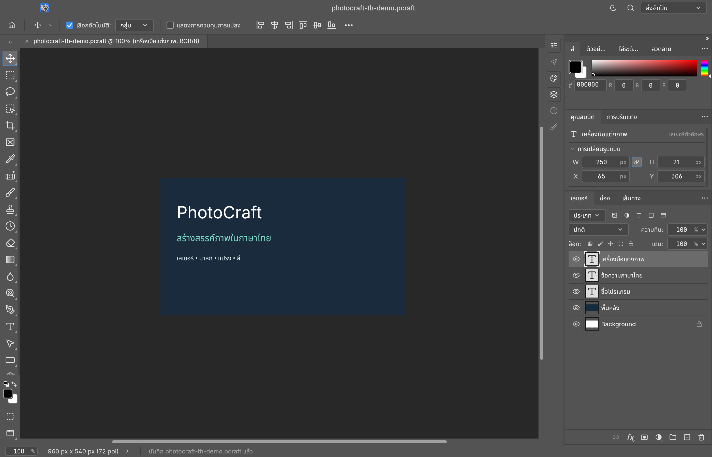
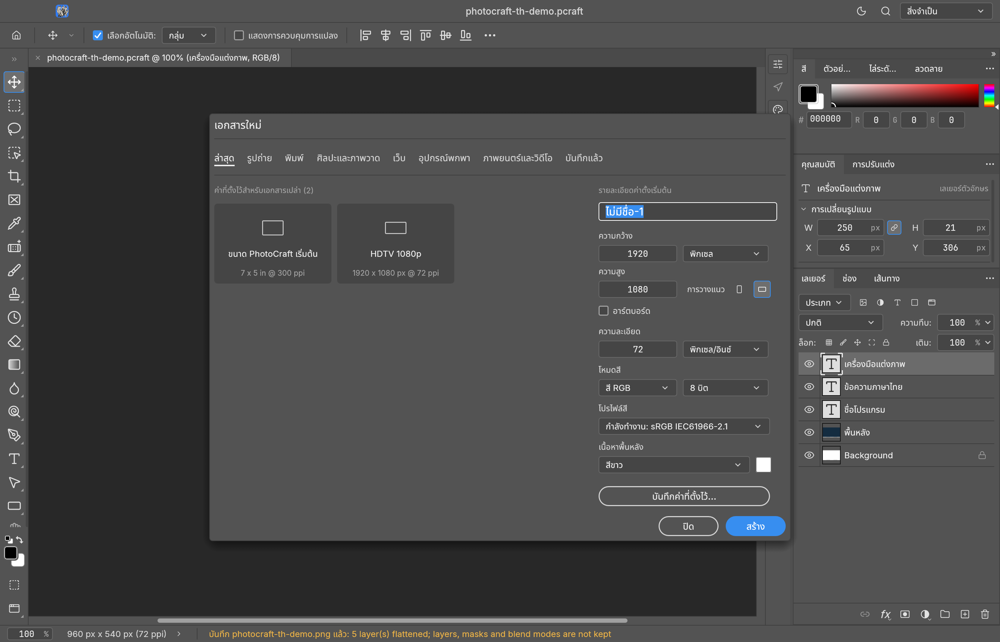

# PhotoCraft TH — โปรแกรมแต่งภาพภาษาไทยสำหรับ Mac

[ดาวน์โหลด DMG / Download](https://github.com/tapanapon-com/photocraft-th/releases/tag/v0.20.1-th.1) · [วันละ Craft / One Per Craft](https://tapanapon.com/one-per-craft) · [English](#english)

PhotoCraft TH เป็นรุ่นปรับแต่งภาษาไทยของ [PhotoCraft โดย storytold](https://github.com/storytold/photocraft) โปรแกรมแก้ไขภาพแบบเนทีฟที่เขียนด้วย Rust ใช้ egui/wgpu สำหรับหน้าจอและการแสดงผล เหมาะสำหรับทดลองทำงานกับภาพ เลเยอร์ มาสก์ แปรง และข้อความ โดยใช้เมนูภาษาไทย

**โครงการนี้เป็นงานแปลอิสระ ไม่ใช่รุ่นทางการหรือผลิตภัณฑ์ที่ได้รับการรับรองจากผู้สร้าง PhotoCraft/ArtCraft ต้นฉบับ** โค้ดเอนจินและคุณสมบัติหลักเป็นผลงานของโครงการต้นฉบับ

## ภาพหน้าจอ

ภาพจากแอป macOS รุ่นภาษาไทย ใช้เอกสารสาธิตที่สร้างขึ้นสำหรับโครงการนี้





## ทำอะไรได้บ้าง

- แก้ไขภาพด้วยเลเยอร์ มาสก์ เครื่องมือเลือก แปรง และการปรับสีตามความสามารถของ PhotoCraft ต้นฉบับ
- เพิ่มข้อความไทยด้วยฟอนต์ Noto Sans Thai ที่แนบในรุ่นติดตั้ง
- บันทึกเอกสาร `.pcraft` เพื่อกลับมาแก้ไข และส่งออกภาพ เช่น PNG
- ใช้ CLI และระบบคำสั่งอัตโนมัติของต้นฉบับ โดยรหัสคำสั่งยังคงเดิม
- เลือก **PhotoCraft › Language › ไทย** และสลับกลับภาษาอังกฤษได้

หน้าจอส่งคำสั่งไปยังเอนจินภาพเดียวกับ CLI คำแปลอยู่ใน `crates/ui-egui/src/i18n/th.tsv` และฝังในแอปตอน build จึงแสดงภาษาไทยได้โดยไม่ต้องเชื่อมต่ออินเทอร์เน็ต การแปลไม่เปลี่ยนรูปแบบไฟล์หรือวิธีคำนวณสี

## ดาวน์โหลดและติดตั้งบน Mac

รุ่น **0.20.1-th.1** สำหรับ **Apple Silicon (arm64)** เท่านั้น ขนาดประมาณ **123 MiB** ทดสอบบน macOS 26.3.1

1. [ดาวน์โหลด PhotoCraft TH DMG](https://github.com/tapanapon-com/photocraft-th/releases/download/v0.20.1-th.1/PhotoCraft-TH-0.20.1-th.1-macOS-arm64.dmg)
2. เปิด DMG แล้วลาก **PhotoCraft.app** ไปยัง **Applications** หากมี PhotoCraft เดิม ให้บันทึกงานและปิดแอปก่อนแทนที่
3. เปิดแอป แล้วเลือก **PhotoCraft › Language › ไทย**

รุ่นนี้เซ็นแบบ **ad-hoc** และ **ยังไม่ผ่าน Apple notarization** macOS อาจแจ้งเตือนเมื่อเปิด หากตรวจสอบแหล่งที่มาแล้ว ให้ใช้ตัวเลือก Open Anyway ใน System Settings › Privacy & Security ตามที่ macOS แสดง ไม่จำเป็นต้องปิดระบบรักษาความปลอดภัยทั้งเครื่อง

SHA-256:

```text
75d1378113bf476f5864ba64e581418f01bf17b4ed8d27395809be7508b0dfcf
```

## ขอบเขตคำแปลและข้อจำกัด

ตารางภาษาไทยมี **4,627 รายการ** เครื่องมือตรวจคีย์จากโค้ดรายงาน **2,272/2,272** ทดสอบภาษาและการสลับภาษาผ่าน **61 รายการ** และ integration ผ่าน **187 รายการ** ตัวเลขความครอบคลุมไม่ได้หมายความว่าทุกข้อความของระบบปฏิบัติการเป็นภาษาไทย

คำแปลใช้ข้อความร่วมและร่างที่ช่วยแปลด้วยโมเดลภาษาในเครื่อง แล้วปรับคำศัพท์และตรวจรูปแบบ ข้อความวินิจฉัยจากเอนจิน/ไลบรารีบางส่วนยังเป็นอังกฤษ ชื่อไฟล์และเลเยอร์ของผู้ใช้ไม่ถูกแปล ชุดทดสอบยังมี **3 รายการเกี่ยวกับการเลือกฟอนต์ที่ไม่ผ่าน** โปรดอ่าน [ผลตรวจและข้อจำกัด](docs/validation-th.md) ก่อนใช้งานจริง และเก็บสำเนาต้นฉบับของงานสำคัญ

## ต้นฉบับ สัญญาอนุญาต และการพัฒนาต่อ

- ต้นฉบับ: [storytold/photocraft](https://github.com/storytold/photocraft) รุ่น 0.20.1 ที่ commit [`8e9277e`](https://github.com/storytold/photocraft/tree/8e9277e20e8d5185ed4259908022a719a647237e)
- [README ต้นฉบับ](README-upstream.md), [เครดิตและทรัพยากร](ATTRIBUTION.md), [NOTICE](NOTICE), [MIT](LICENSE-MIT), [Apache-2.0](LICENSE-APACHE)
- โค้ดต้นฉบับและคำแปลใช้ MIT OR Apache-2.0; `LICENSE` ที่สร้างตอนตั้ง repository ใช้กับส่วนที่เจ้าของ repository มีสิทธิ์ให้อนุญาต ไม่แทนที่เครดิตหรือสัญญาอนุญาตต้นฉบับ
- ฟอนต์จาก [storytold/craft-fonts](https://github.com/storytold/craft-fonts) พิน `b076417b5880bd4154bd22f00695b1d28c6bea83` พร้อมใบอนุญาต OFL ในแอป; ชื่อและตราสินค้าต้นฉบับยังอยู่ภายใต้เงื่อนไขของเจ้าของ
- [คู่มือภาษาไทยและวิธี build](docs/localization-th.md)

## English

**PhotoCraft TH is an independent Thai localization of [storytold/photocraft](https://github.com/storytold/photocraft), not an official or endorsed upstream release.** The original PhotoCraft contributors created the image engine and core features. This repository adds Thai interface text, localization checks and local macOS packaging.

### What it does

PhotoCraft is a native Rust image editor with an egui/wgpu interface. It supports image editing workflows involving layers, masks, selections, brushes, color adjustments and text, subject to upstream's documented limitations. Save editable `.pcraft` documents and export flat images such as PNG. The desktop UI, CLI and automation interface share the same command engine.

The Thai catalog is embedded during compilation and works offline. Command IDs, image-processing behavior and document formats retain upstream's implementation. The macOS package includes Noto Sans Thai through the upstream font bundle. Select **PhotoCraft › Language › ไทย** to use Thai, or switch back to English from the same menu.

### Mac download

[Download PhotoCraft TH 0.20.1-th.1 for Apple Silicon](https://github.com/tapanapon-com/photocraft-th/releases/download/v0.20.1-th.1/PhotoCraft-TH-0.20.1-th.1-macOS-arm64.dmg) — approximately 123 MiB, arm64 only, tested on macOS 26.3.1. Open the DMG and drag PhotoCraft to Applications. Save your work and quit any existing PhotoCraft installation before replacing it.

The app is **ad-hoc signed and not Apple-notarized**. macOS may require an explicit Open Anyway choice under Privacy & Security after you verify the source. Do not disable system-wide security protections. The SHA-256 above and the release checksum file identify this exact download.

### Coverage and validation

The catalog has **4,627 entries**, covering **2,272/2,272 source-extracted keys**. **61 localization tests** and **187 integration tests** passed. This is catalog coverage, not a promise that every OS or library diagnostic is translated. Technical names and user document content retain their original text. Translations started from shared strings and a locally machine-assisted draft, followed by terminology and formatting checks.

**Three font-selection tests remain failing.** The complete suite is not green; see the [validation report](docs/validation-th.md). Keep original copies of important files while evaluating this prerelease.

### Source and credits

Based on upstream 0.20.1, revision `8e9277e20e8d5185ed4259908022a719a647237e`. The distributed executable was built from localization revision `23201e6fe0ec9050aaeb12fa61b8af1928aaaed7`; later repository changes add publishing documentation and screenshots.

Read the [upstream README](README-upstream.md), [attribution](ATTRIBUTION.md), [MIT](LICENSE-MIT) and [Apache-2.0](LICENSE-APACHE) notices. Retain original copyright and asset licenses when redistributing. The repository-initialization `LICENSE` does not replace upstream notices. Upstream branding is subject to its own terms.

For build instructions, see the [bilingual localization guide](docs/localization-th.md). Product news and downloads are collected at [One Per Craft by Tapanapon](https://tapanapon.com/one-per-craft).
